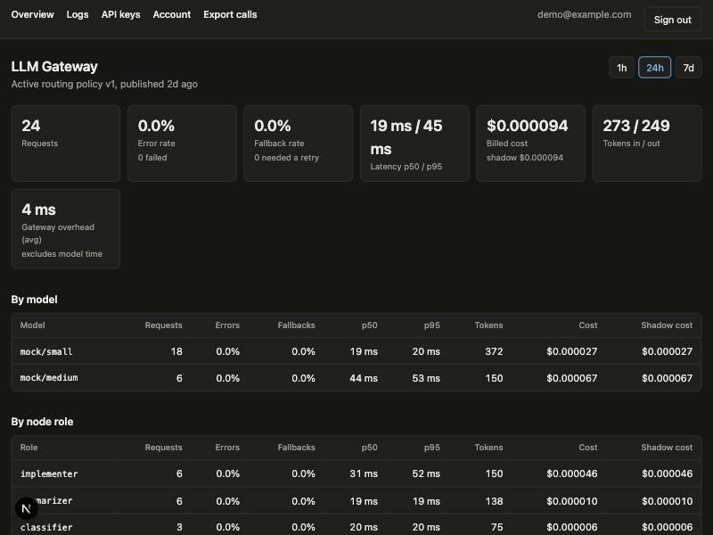

<!-- portfolio: section=ai-rag -->
# LLM Gateway

An OpenAI-compatible gateway that routes each LLM call to the right model for the task, with tracing, cost tracking and a dashboard.

**Live demo:** https://llm-gateway-evals.vercel.app



Keywords: `ai-rag` · LLM gateway · model routing · tracing · evals · cost tracking · OpenAI-compatible

## Capabilities

- **Drop-in OpenAI-compatible API.** Chat completions with streaming; point any OpenAI SDK at the gateway by changing the base URL.
- **Automatic routing.** Picks a model per request from task type, complexity, context size, tool and JSON needs, cost and latency, or pin a specific model when you want one.
- **Role-aware routing for multi-agent workflows.** For example, a reviewer call is routed to a different model family than the one that produced the work.
- **Retries and fallbacks.** If a provider errors, times out or returns invalid output, the request moves to the next best model within a retry budget.
- **Cost tracking.** Real cost plus a "shadow" cost at list price, so free-tier and local models still produce meaningful numbers.
- **Per-call tracing.** Every call and attempt is stored with its routing reason, tokens, latency, time to first token and error class.
- **Versioned routing policy.** Routing behavior lives in a policy you can update without redeploying.
- **Dashboard.** Cost, latency, errors, fallbacks and recent requests by model, node role and task type.
- **Providers.** Ollama, Groq, OpenRouter and any other OpenAI-compatible API, plus a mock provider for local development and tests.

## Installation

Requirements: Docker, Python 3.11+, [uv](https://docs.astral.sh/uv/), Node 20+.

```bash
git clone https://github.com/arnavk2319/llm-gateway-evals.git
cd llm-gateway-evals
cp .env.example .env
docker compose up -d --wait postgres
cd gateway && uv sync && uv run uvicorn app.main:app --port 8000
```

Send a request:

```bash
curl -s localhost:8000/v1/chat/completions \
  -H 'content-type: application/json' \
  -d '{"messages":[{"role":"user","content":"hello"}]}'
```

Run the dashboard in another terminal:

```bash
cd dashboard && cp .env.example .env.local && npm install && npm run dev   # http://localhost:3100
```

Without `DATABASE_URL` the gateway runs with an in-memory event store.

### Providers

The mock provider is on by default, so everything works without API keys. To use real models, set variables in `.env`:

| Provider | Variable | Notes |
|---|---|---|
| Ollama (local) | `OLLAMA_ENABLED=1` | requires a running `ollama serve` |
| Groq | `GROQ_API_KEY` | |
| OpenRouter | `OPENROUTER_API_KEY` | |
| Hide the mock models | `GATEWAY_DISABLE_MOCK=1` | once real providers are configured |

Model ids and prices are defined in `gateway/app/data/seed_policy.yaml`; verify them against each provider before relying on them.
